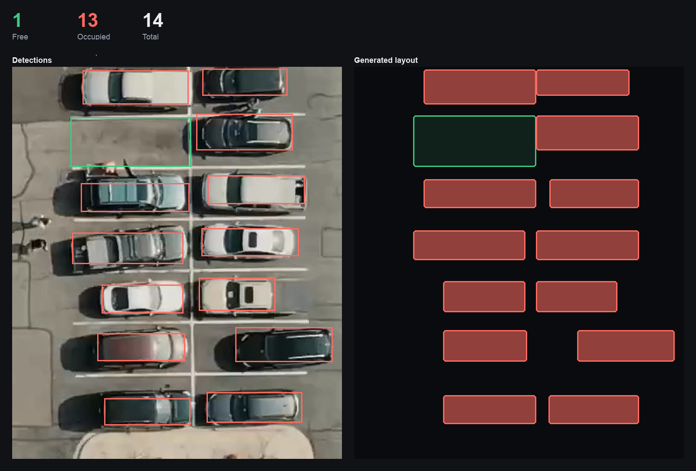

# ParkEasy

[](https://ammar-ghazal.github.io/ParkEasy/)
[](https://universe.roboflow.com/parkeasy/parking-space-detect)
[](LICENSE)

Turns a photo of a parking lot into a clean layout showing which spaces are free and which are taken.

Built as the software side of my 2025 University of Waterloo capstone project.



*Left: what the model detects. Right: the layout generated from it. Real output from the live demo.*

## How it works

1. A parking-lot photo is sent to an object-detection model hosted on [Roboflow](https://roboflow.com), which returns a box for each space labelled `free` or `car`.
2. The boxes are snapped to shared grid lines so the rows and columns line up (`RectangleAligner` in `generate-layout.py`).
3. The layout is drawn with OpenCV: green outlines for free spaces, red outlines with a car icon for occupied ones.

## The model

I trained the detection model for this project: [parking-space-detect](https://universe.roboflow.com/parkeasy/parking-space-detect) on Roboflow Universe.

- YOLOv8 object detection, two classes: `car` and `free`
- 3,246 images, compiled from open-source parking-lot datasets
- mAP@50 98.8%, precision 97.9%, recall 97.0%
- Dataset license: CC BY 4.0

## Try the model

A small React page for testing the model in the browser: https://ammar-ghazal.github.io/ParkEasy/

Upload a photo and it shows the detections on the photo next to the generated layout, with free and occupied counts. The source is in `web/`.

A small serverless function (`web/api/detect.ts`) holds the API key and forwards photos to Roboflow. It only accepts this project's models, limits image size, and rate-limits each visitor.

### Deploying your own copy

1. Import this repository into [Vercel](https://vercel.com/new) and set the **Root Directory** to `web`.
2. Add an environment variable named `ROBOFLOW_API_KEY` with your key, then deploy. The Vercel URL is now a working copy of the site.
3. To make the GitHub Pages copy use it too, add a repository variable named `API_URL` with the Vercel URL (Settings → Secrets and variables → Actions → Variables) and re-run the Pages workflow. If your Pages site is on a different origin, list it in the function's `ALLOWED_ORIGINS` variable.

Without `API_URL`, the Pages build falls back to asking each visitor for their own Roboflow key.

## Run it

Requires Python 3.10 or newer and a Roboflow API key.

```sh
python -m venv .venv
source .venv/bin/activate
pip install -r requirements.txt
cp .env.example .env   # then put your key in .env
```

Put one or more photos in `parkinglotlayout/parkinglotimages/`, then:

```sh
python parkinglotlayout/generate-layout.py
```

Each layout opens in a window; press any key to move to the next photo.


## License

GNU Affero General Public License v3.0. See [LICENSE](LICENSE).

Copyright (C) 2025 Ammar Ghazal
