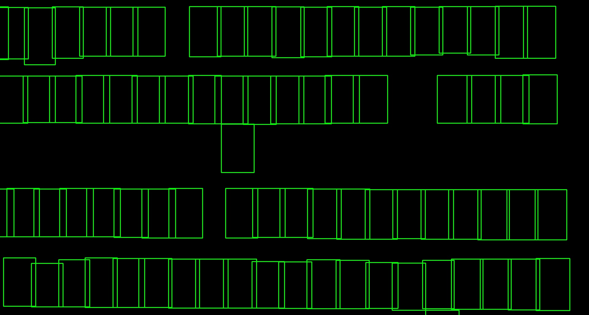

# ParkEasy

Turns a photo of a parking lot into a clean layout showing which spaces are free and which are taken.

This is the software side of a 2024 University of Waterloo capstone project. The original system also had camera and messaging code written by teammates; this repository contains only the layout generation, which I wrote.



## How it works

1. A parking-lot photo is sent to a hosted [Roboflow](https://roboflow.com) object-detection model, which returns a box for each space labelled `free` or `car`.
2. The boxes are snapped to shared grid lines so the rows and columns line up (`RectangleAligner` in `final.py`).
3. The layout is drawn with OpenCV: green outlines for free spaces, red outlines with a car icon for occupied ones.

## Run it

Requires Python 3.10 or newer and a Roboflow API key.

```sh
python -m venv .venv
source .venv/bin/activate
pip install -r requirements.txt
export ROBOFLOW_API_KEY=your-key
```

Put one or more photos in `parkinglotlayout/parkinglotimages/`, then:

```sh
python parkinglotlayout/final.py
```

Each layout opens in a window; press any key to move to the next photo.

## Status

The script works locally but is a prototype. The plan to turn it into a small website, where a visitor uploads a photo and gets the layout back, is in [docs/spec.md](docs/spec.md), along with the known issues to fix on the way.
